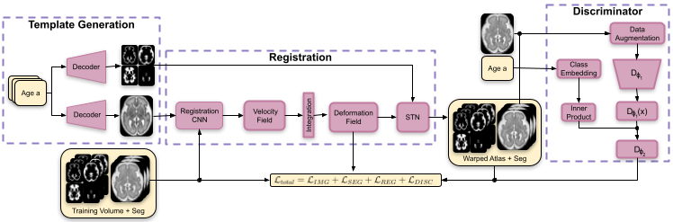
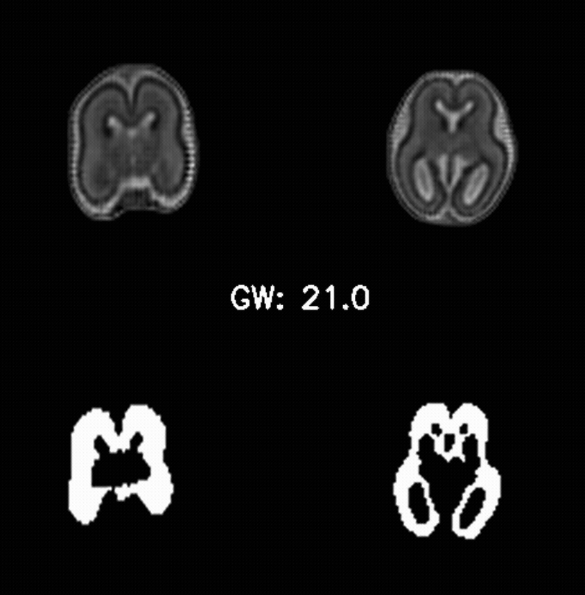

# Conditional Fetal Brain Atlas Learning for Automatic Tissue Segmentation
[](https://arxiv.org/abs/2508.04522)
[](https://hub.docker.com/r/jtischer29/fetal_atlas)

A TensorFlow–based pipeline that constructs a fetal brain atlas via registration, guided by a projection discriminator.

<table>
  <tr>
    <td></td>
    <td></td>
  </tr>
    <caption style="caption-side: bottom; font-style: italic; padding: 8px;">
  </caption>
</table>

## Instructions - How to use
The code and environment are embedded into a docker container and can be called as described in the following example script. In the config file
$CONFIG_FILE training parameters, such as num_epoch, learning rate, hyperparameters, and model parameters are defined.   

```bash
#!/bin/bash
# add slurm configs here
#
#

IMAGE_NAME="jtischer29/fetal_atlas:tensorflow"
CONFIG_FILE="/your-project-path/config.json"

# RUN WITH SLURM/PYXIS SUPPORT
srun --container-writable \
     --container-image=${IMAGE_NAME} \
     python -u /app/train_CAL.py ${CONFIG_FILE}

# OR RUN AS DOCKER CONTAINER 
docker run --rm -it \
  "$IMAGE_NAME" \
  python /app/train_CAL.py ${CONFIG_FILE}

```

### Dataset structure
Structure of the training dataset.  
```tree
dataset/  
├── train/  
│ ├── images/  
│ │ ├── sub-0001-ses-01012025-svr.nii.gz  #3D volume with isotropic voxel spacing (e.g. 1mm)
| | ├── sub-0002-ses-08022021-svr.nii.gz  
│ │ └── sub-0002-ses-02022024-svr.nii.gz   
│ └── labels/  
│ │ ├── sub-0001-ses-01012025-seg.nii.gz  #one hot encoded segmentation maps
| | ├── sub-0002-ses-08022021-seg.nii.gz  
│ │ └── sub-0002-ses-02022024-seg.nii.gz  
│ └── metadata.csv #here are the conditions of the training data stored (e.g. gestational age) 
├── test/  
...  
...
```
with metadata.csv structured as:  
with min(condition) = 0
```
subject;condition
sub-0001-ses-01012025;0  
sub-0002-ses-08022021;4
sub-0002-ses-02022024;12 
...
```

### Config file 
```.json
{
  "input": {
    "data_path": "data",
    "img_suffix": "-svr.nii.gz",
    "seg_suffix": "-seg.nii.gz",
    "img_res": [128, 128, 96],
    "cond_dim": 1,                    # dimension of condition
    "cond_num": 17,                   # number of unique conditions
    "seg_channels": 6                 # number of brain labels
  },
  "model": {
    "vxm_unet_arch_enc": [16, 32, 32, 32],
    "vxm_unet_arch_dec": [32, 32, 32, 32, 32, 16, 16]
  },
  "training": {
    "num_epoch": 500,
    "lr_gen": 0.0001,
    "lr_disc": 0.0003,
    "beta_1": 0.0,
    "beta_2": 0.9,
    "epsilon": 0.0000001,
    "batch_size": 1,
    "weight_loss_img": 1.0,
    "weight_loss_seg": 0.5,
    "weight_loss_reg_def_magnitude": 1.0,
    "weight_loss_reg_def_smoothness": 0.8,
    "weight_loss_adverserial": 0.25, 
    "bidir": true,
    "disc_loss": "MSE",
    "weight_bidir_forward": 0.9,
    "weight_bidir_backward": 0.1,

    "train_step_gen": 1,
    "train_step_disc": 1
  },
  "output_model_path": "out",
  "name_best_model_weights": "best_model_weights",
  "output_inference_path": "inference"
}
```

## How to cite
```
@inproceedings{FetalAtlas2025,
  title={Conditional Fetal Brain Atlas Learning for Automatic Tissue Segmentation},
  author={J. Tischer, P. Kienast, M Stuempflen, G. Kasprian, G. Langs, and R. Licandro},
  booktitle={Perinatal, Preterm and Paediatric Image Analysis (PIPPI), MICCAI 2025},
  year={2025},
  publisher={Springer Nature Switzerland},
  address={Cham},
  pages={36--47},
  doi={https://doi.org/10.1007/978-3-032-05997-0_4}
}
```

## Acknowledgment
<table>
  <tr>
    <td></td>
    <td>The financial support by the Austrian Federal Ministry of Labour and Economy, the National Foundation for Research, Technology and Development and the Christian Doppler Research Association is gratefully acknowledged.</td>
  </tr>
</table>

This repo makes extensive usage of the [VoxelMorph](https://github.com/voxelmorph/voxelmorph) and [Atlas-GAN](https://github.com/neel-dey/Atlas-GAN) library